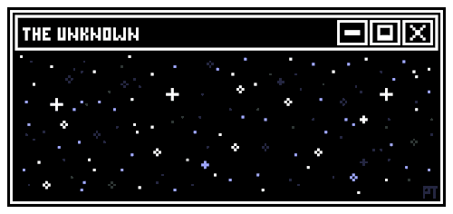

  

 

 

&nbsp;&nbsp;&nbsp;

 

---

## 🛠️ Languages and Tools

---

## 🚀 What we're up to

- 🔭 **Current focus:** [ST-SoftwareTool](https://st-softwaretool.pages.dev/)
- 📑 **Learning:** Cyber Security and Reverse Engineering
- 🦺 **Open to feedback:** help and suggestions for improving our projects are always welcome
- 🌐 **Main website:** [siimole-official-website.pages.dev](https://siimole-official-website.pages.dev/), which also includes our Privacy Policy and Terms of Use pages
- 📫 **Contact:** for business inquiries, project discussions, or technical support, reach our team at [siimole.official@gmail.com](mailto:siimole.official@gmail.com) or [siimole.official.first@gmail.com](mailto:siimole.official.first@gmail.com)

---

## 🏢 A bit about our company

We build practical software: antivirus and security utilities, VPN and networking tools, desktop applications with custom UIs, file organization utilities, and web front-ends, all designed to be functional and useful in everyday work.

Our current focus is **ST-SoftwareTool**, a terminal-powered application manager for Windows. It lets you scan, launch, pin, and organise all your installed apps from a single command-line interface, or switch to the full GUI when you need it, with **ST-VPN** and **ST-AntiVirus** built right in. The project is completely free, and more information on ST-SoftwareTool and the rest of our work is available on our website: **[st-softwaretool.pages.dev](https://st-softwaretool.pages.dev/)**

---

  

**Unauthorized use of SIImole's project code, company name, or intellectual property is strictly prohibited and will be prosecuted to the fullest extent of the law.**

 

© 2026 SIImole. All rights reserved.

For questions, permissions, or to report misuse of our work, contact us at 
[siimole.official@gmail.com](mailto:siimole.official@gmail.com) · [siimole.official.first@gmail.com](mailto:siimole.official.first@gmail.com)

